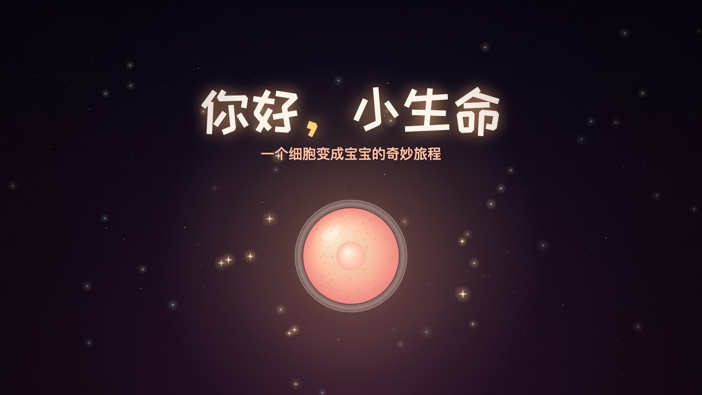

# 你好，小生命

**一个细胞变成宝宝的奇妙旅程**。这是一部科普动画短片，时长 9 分 05 秒，画面 1920×1080、30fps，配有中文旁白和字幕。

- 适合人群：4–10 岁的孩子与家长一起观看，也适合准父母和中小学生命教育课堂。
- 成片：`output/你好小生命.mp4`，字幕文件为 `output/你好小生命.srt`。
- 互动网页版：`index.html`。它可以暂停、跳章节，也可以单独开关字幕和知识卡。

**成片下载**：前往本仓库的 [Releases](../../releases) 页面，下载完整 MP4、SRT 字幕和 WAV 混音。成片和 WAV 混音通过 Release 提供；仓库保留互动网页所需的 M4A 音轨和旁白素材。



## 作品简介

一粒沙子旁边有一个小光点，比沙子还小。那就是很久很久以前的“你”。

镜头跟着这个细胞往回走，依次看到卵子和精子相遇、受精卵分裂、胚胎着床和第一次心跳。接着用水果比大小，看宝宝一周周长大。宝宝在羊水里吮手指、打嗝、尝味道，妈妈的身体也在为他努力改变。最后是分娩和第一声啼哭。

结尾回到观众自己：“每一个人，都走过这段奇妙的旅程。当然，也包括你。”

## 创作理念

1. **两层叙事，孩子和大人各取所需。** 旁白用孩子听得懂的比喻，比如说明书、软软的床、交换站、小门。屏幕右侧同步出现“给大人的小知识”卡片，一共 40 张，写的是准确的医学数字和机制。孩子听故事时，家长同时在学习。网页版可以单独关掉知识卡。
2. **把抽象的尺度变成看得见的概念。**
   - 真实比例：沙粒与细胞约 5:1。精子全长约为卵子直径的一半，片中按比例绘制。
   - 水果尺：树莓、青柠、香蕉、玉米、茄子、哈密瓜、西瓜。
   - 40 颗孕周进度珠一直显示在左上角，孩子能直观感受到“40 周有多长”。
   - 细胞计数：1 → 2 → 4 → 8 → 16 → 32 → 100 多个。
   - 宫口开大的刻度，10 厘米约等于一个甜甜圈。
3. **敏感话题的处理方式。** 全片用“来自爸爸的精子、来自妈妈的卵子”讲受精，符合联合国教科文组织《国际性教育技术指导纲要》对低龄段的建议：诚实、简单、用正确的名称。性行为本身不出现在画面里，片尾“给大人的话”引导家长接着回答孩子的追问。
4. **包容不同家庭。** 片中讲到了试管婴儿和剖宫产（“不管是哪一种方式，都是了不起的出生！”），也照顾到独生子女家庭（“家里人讲的故事”）。
5. **情感落点。** 第十章让孩子理解妈妈在孕期的付出（“妈妈，辛苦啦！”）。尾声用一段旅程回顾，把科学知识落回“你”自己。

## 科学性

所有数字都以主流教材和指南为准：Langman 医学胚胎学、《妇产科学》（人民卫生出版社）、WHO、ACOG。剧本另外做过一轮逐条事实核查，修正了以下几处：着床要到受精后第 10–12 天才完成；胎心在孕 9 周左右达到峰值，之后回落到 110–160 次/分；足月的定义是 37 周至不满 42 周；宝宝最熟悉妈妈的声音，是因为声音还能通过妈妈的身体传导。

片中的孕周按医学惯例从末次月经第一天算起，第八章的知识卡专门解释了“孕周”和受精后天数的区别。

## 章节

| 时间 | 章节 | 标题 | 知识卡 |
|---|---|---|---|
| 0:00 | 序章 | 你从哪里来 | – |
| 0:27 | 第一章 | 两个细胞 | 2 |
| 0:57 | 第二章 | 奇妙的相遇 | 3 |
| 1:34 | 第三章 | 生命说明书（DNA、23 对染色体） | 2 |
| 2:03 | 第四章 | 一变二，二变四（卵裂、囊胚） | 3 |
| 2:34 | 第五章 | 一张软软的床（着床、hCG） | 3 |
| 3:04 | 第六章 | 扑通，扑通（心跳、叶酸） | 3 |
| 3:31 | 第七章 | 生命线（胎盘、脐带、肚脐） | 3 |
| 4:07 | 第八章 | 一天天长大（8–40 周） | 8 |
| 5:36 | 第九章 | 羊水里的小世界 | 3 |
| 6:07 | 第十章 | 妈妈的身体 | 3 |
| 6:52 | 第十一章 | 出发！（宫缩、囟门、剖宫产） | 3 |
| 7:35 | 第十二章 | 第一口气（肺、卵圆孔） | 2 |
| 8:04 | 尾声 | 你好呀 | 2 |
| 8:49 | 片尾 | 给大人的话 · 制作信息 | – |

## 技术实现

全片没有使用任何图片、视频或音频素材。

- **画面**：全部用 Canvas 2D 代码逐帧绘制，每一帧都是时间 t 的纯函数，可以随机跳转、并行渲染。胎儿是参数化模型：头身比、四肢、胎毛和肤色从孕 8 周连续变化到足月。
- **旁白**：MiniMax 语音合成。多音字用发音词典指定，例如“着床”读 zhuó。需要在环境变量 `MINIMAX_API_KEY` 里配置密钥；把 `src/script.js` 里的 `voice` 改成 `{ engine: 'say', name: 'Tingting', rate: 172 }` 可以切回 macOS 自带语音。
- **音乐与音效**：`tools/build_audio.py` 用 numpy 实时合成。每章有自己的情绪、和声与动机；旁白出现时配乐会自动压低。心跳、分裂的“啵”、宫缩和子宫里的环境声都与画面事件共用同一份时间表。
- **渲染**：headless Chrome 多进程逐帧截图，交给 ffmpeg 编码为 H.264，再与 AAC 音轨合并。

## 文件与重建

```
index.html            互动播放器（也是渲染器）
src/script.js         剧本：旁白、知识卡、事件时间（唯一的内容来源）
src/core.js           时间轴、字幕、知识卡、章节与孕周进度
src/art.js            美术库：细胞、胚胎、胎儿、妈妈、水果……
src/scenes.js         场景：序章—第六章
src/scenes2.js        场景：第七章—片尾
tools/                配音、配乐、渲染、检查脚本
assets/               字体、旁白音频、合成好的音轨
output/               成片 MP4 与 SRT 字幕
```

**本地观看网页版**：运行 `node tools/serve.mjs`，然后打开 http://localhost:8765 。直接双击 `index.html` 也能看，但部分浏览器会拦截本地音频。

修改剧本后，按下面的顺序重新生成（需要 macOS、Node 22+、Python 3 + numpy、ffmpeg，以及环境变量 `MINIMAX_API_KEY`；`tools/` 里先执行一次 `npm i`）：

```bash
node tools/build_voice.mjs      # 配音（只合成改动过的句子）+ 时间轴
python3 tools/build_audio.py    # 配乐音效混音
node tools/check.mjs            # 逐帧检查有无报错
node tools/render.mjs           # 渲染 MP4（约 5 分钟）
node tools/make_srt.mjs         # 字幕文件
```

**署名**：在 `src/script.js` 末尾的 `credits` 里加一行，例如 `['创作', '你的名字']`，然后重新渲染。

## 字体

互动网页使用站酷快乐体（ZCOOL KuaiLe），字体文件与 Google Fonts 上游版本一致。原始许可证见 [OFL.txt](assets/fonts/OFL.txt)，来源见 [Google Fonts 字体目录](https://github.com/google/fonts/tree/main/ofl/zcoolkuaile)。
